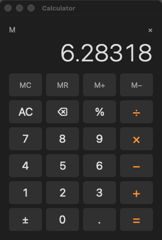

# loup-macos-calculator

A desktop calculator for macOS, written in Loup on the
[`appkit`](https://github.com/myronccai/loup-macos-appkit) library
(Loup proxy classes over AppKit).



## Getting started

**Requirements**

- macOS on Apple silicon or Intel, with the Xcode Command Line Tools
  (`xcode-select --install`).
- A Loup toolchain of version **newer than 1.27.0**, with `loup`, `loup-build`,
  `loup-llvm`, `loup-test` and `loup-bootstrap` on `PATH`. This app needs
  fixes made after the 1.27.0 release ([Loup releases](https://github.com/code-craft-ai-company/loup-releases/releases)).
- The [`loup-macos-appkit`](https://github.com/myronccai/loup-macos-appkit)
  library, checked out **next to** this repository: the manifest refers to it
  as `appkit = { path = "../loup-macos-appkit" }`.

**Get the code** — clone both repositories into the same directory:

```sh
git clone https://github.com/myronccai/loup-macos-appkit
git clone https://github.com/myronccai/loup-macos-calculator
cd loup-macos-calculator
```

**Build, run, test and self-test** (from inside `loup-macos-calculator/`):

```sh
loup build                                     # → ./loup-macos-calculator
./loup-macos-calculator                        # the calculator window
loup test --strict src                         # the engine's unit tests
./loup-macos-calculator --self-test            # drives the window; output must equal selftest.out
bash ../loup-macos-appkit/run_all.sh loup-macos-calculator   # the full gate
```

If linking fails with `tapi error … unknown architecture`, point `SDKROOT`
at an older SDK, e.g.
`export SDKROOT=/Library/Developer/CommandLineTools/SDKs/MacOSX26.5.sdk`.
[Build, run, test](#build-run-test) below has the details.

## What it does

- **Keypad:** digits, decimal point, + − × ÷, =, % and ± (sign change), the
  clear key (**C** clears the number being typed, then **AC** clears
  everything), ⌫ (backspace), and the memory keys MC, MR, M+ and M−.
- **Immediate execution**, like a pocket calculator: `2 + 3 × 4 =` is
  (2 + 3) × 4 = 20. Pressing another operator before typing replaces the
  pending one.
- **Repeated =** repeats the last operation: `2 + 3 = = =` shows 5, 8, 11. A
  new number followed by = takes the same operation (`= 10 =` → 13).
  `5 + =` is 5 + 5.
- **Percent:** after + or − it is that percent of the left operand
  (`50 + 10 % =` → 55); otherwise it divides by 100.
- **Errors:** dividing by zero (or an overflow) shows `Error`; every key but
  the clear key is ignored until it is pressed. The memory survives.
- **Sensible numbers:** results are rounded to 15 significant digits when
  stored and shown with at most 12, so `0.1 + 0.2` is `0.3` and
  `1 ÷ 3 × 3` is `1`. Thousands are grouped (`1,234,567`); from 10¹² up and
  below 10⁻⁶ the display switches to scientific notation, still with up to
  12 significant digits (`9.99998000001e14`, `3.33333333333e-7`). The
  display font shrinks to fit a long number, so nothing is cut off.
- **Flags** above the display show **M** while the memory holds a value and
  the pending operator (`×`).
- **Keyboard:** the buttons' key equivalents take `0`–`9` `.` `+` `-` `*` `/`
  `%` `=`, Escape (clear) and Delete (⌫). The **Calculate** menu (between
  Edit and Window) adds Return and the numeric keypad's Enter (=), `c`
  (clear), ⌥- (±), and ⌃L ⌃R ⌃P ⌃Q for MC, MR, M+ and M− (the memory
  shortcuts of Windows Calculator).
- **Edit ▸ Copy** (⌘C) copies the displayed number (without the grouping
  commas); **Edit ▸ Paste** (⌘V) puts a number from the clipboard on the
  display (`1,234.5`, ` -7 ` and so on; a beep when it is not a number).
  Both are greyed out while the display shows `Error`.
- Standard app menu (About, Hide, Quit ⌘Q) and Window menu; the window has a
  fixed size, and closing it quits.

## Build, run, test

You need macOS, the Xcode Command Line Tools, the Loup toolchain newer than
1.27.0 (`loup`, `loup-build`, `loup-llvm`, `loup-test`, `loup-bootstrap`) on
`PATH`, and a `loup-macos-appkit` checkout next to this one (see
[Getting started](#getting-started)). If linking
fails with `tapi error … unknown architecture`, point `SDKROOT` at an SDK
your linker understands, e.g.
`export SDKROOT=/Library/Developer/CommandLineTools/SDKs/MacOSX26.5.sdk`.

```sh
cd loup-macos-calculator                 # this repository's checkout
loup build                              # self-hosted toolchain → ./loup-macos-calculator
loup-bootstrap build --target native    # or the Stage0 (Rust) driver
./loup-macos-calculator                      # the calculator window

loup test --strict src                  # the engine's unit tests (interpreted)
./loup-macos-calculator --self-test          # drives the window, prints selftest.out
./loup-macos-calculator --self-test shot.png # … and writes a snapshot of the window
```

The self-test is quiet: no Dock icon, no focus, a transparent click-through
window. It clicks button sequences (`12.5 × 4 =`, `1 ÷ 3 × 3 =`, `7 ÷ 0 =`,
AC / C, memory store and recall, `%`, `±`, repeated `=`, a 19-character
result), presses keys through the buttons' key equivalents and the Calculate
menu (`Window.sendKey`), uses Edit ▸ Copy / Paste from the menu
(`MenuItem.perform`) and the keyboard on a saved-and-restored clipboard,
checks that the keypad-Enter item is hidden with a working shortcut, and
prints the display (read back from the display label) after each step. It
also checks that every number shown fits the display. Its output must equal
[`selftest.out`](selftest.out) on both drivers.

The gate for this app (both builds, both self-tests, `loup test`) is
`run_all.sh` in the
[`loup-macos-appkit`](https://github.com/myronccai/loup-macos-appkit)
repository; it treats the directory holding the checkouts as its workspace.
Run it from inside `loup-macos-calculator/`:

```sh
bash ../loup-macos-appkit/run_all.sh loup-macos-calculator                # both drivers, both self-tests, loup test
bash ../loup-macos-appkit/run_all.sh --screenshots loup-macos-calculator  # … and refreshes screenshot.png
```

## Structure

| File | Mode | What it holds |
|---|---|---|
| `loup-macos-calculator.lppkg` | | the manifest: entry `src/main.lphc`, `host.native`, native delivery, the `appkit` path dependency, `-framework AppKit` |
| `src/main.lphc` | `host.native` | the window, keypad, menus and Copy / Paste (appkit proxies only, no raw Objective-C), and the `--self-test` driver |
| `src/calculator.loup` | `host.dual` | the engine: a `Calculator` state struct and `press(state, key)`, which returns the next state; display text, clear-key title, pending operator, paste |
| `src/numformat.loup` | `host.dual` | rounding (`normalize`, `roundSignificant`), result and entry formatting, entry parsing — integer digit extraction only, so every lane prints the same text |
| `src/calculator_test.lpscr` | `host.scripted` | `loup test` tests of the state machine |
| `src/numformat_test.lpscr` | `host.scripted` | `loup test` tests of the number formatting |
| `selftest.out` | | the expected `--self-test` output |
| `LICENSE` | | the MIT license |
| `screenshot.png` | | the window, written by the self-test |

The UI keeps one `Calculator` value in a module variable. Every button,
key equivalent and Calculate menu item calls `pressKey(key)`, which replaces
it with `press(g_calc, key)` and refreshes the labels; the window never does
arithmetic itself.

## appkit modules and controls used

- `appkit.app` — `appInit` (app, Edit and Window menus), `Window`
  (`setResizable(false)`, `fitToContent`, `center`; in the self-test
  `sendKey`, `isResizable`, `snapshot`), `Menu.addItemWithModifiers` with the
  `MOD_*` masks, `Menu.addHiddenItem` (keypad Enter: a hidden item whose
  shortcut still works) and `addMenuBefore` (the Calculate menu),
  `onStandardAction` / `setStandardActionEnabled` (Edit ▸ Copy / Paste with
  no text view in the window), `editMenu` / `menuBarMenu` /
  `Menu.itemWithTitle` / `MenuItem.perform` / `isEnabled` / `isHidden` /
  `allowsKeyEquivalentWhenHidden` (the self-test's menu clicks and
  read-backs), `after` (the self-test timer), `run` / `quit`, `isSelfTest`.
- `appkit.controls` — `Label` (display and flags: `applyTextColor`,
  `setShrinkToFit`, `textWidth`), `Button` (keypad: bezel style, size, key
  equivalents, `setTitleColor`, `onClick`, `click`, `title`), `systemFont`,
  `monospacedDigitSystemFont` with `WEIGHT_LIGHT`, `systemColor` with
  `COLOR_SYSTEM_ORANGE` / `COLOR_SECONDARY_LABEL`, `TEXT_RIGHT`.
- `appkit.layout` — `GridView` (the 4 × 6 keypad), `VStack` / `HStack`
  (display column, flag row, spacers), `layoutNow`.
- `appkit.dialogs` — `copyText` / `pasteText`, `saveClipboard` /
  `restoreClipboard` (the self-test leaves the clipboard as it found it),
  `beep`.

The `appkit` library itself, its reference documentation (`docs/`), probes
for every module and the gate script live in
[myronccai/loup-macos-appkit](https://github.com/myronccai/loup-macos-appkit).

## License

MIT — see [LICENSE](LICENSE). Copyright (c) 2026 Code Craft AI LLC.
